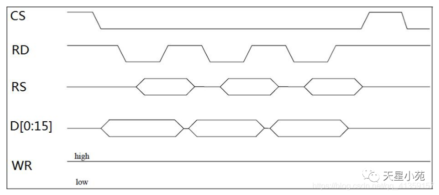
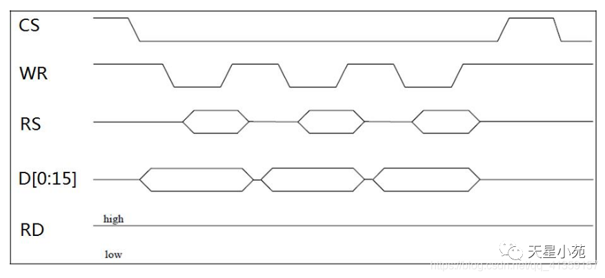

# LCD屏幕实验
## LCD屏幕原理
### 8080 spi iic这三种协议之间的区别
对比维度8080 并行总线（80-Series MPU）   PDFSPI（Serial Peripheral Interface）   PDFI2C / IIC（Inter-Integrated Circuit）   PDF通信机制并行传输（多位数据同时传输）   同步全双工串行传输（逐位传输）   同步半双工串行传输（总线仲裁、开漏双向）   信号线数量较多（8/16/24 根数据线 + 4~5 根控制线）   较少（通常 4 根线，也可缩减为 3 线）   最少（仅 2 根信号线：SCL、SDA）   典型引脚定义CSX（片选）、WRX（写）、RDX（读）、D/CX（命令/数据）、D[15:0]   CS/NSS（片选）、SCK（时钟）、MOSI/SDI（主出从入）、MISO/SDO（主入从出）   SCL（时钟线）、SDA（双向数据线）   总线拓扑 / 寻址依靠独立的**片选引脚（CS/NE）**区分设备（点对点总线）   依靠硬件**片选线（CS/SS）**逐个选中从机   软件地址寻址（所有从机挂在同一对线上，靠从机地址匹配）   传输速率与吞吐极高（单个总线周期吞吐 8/16/24 bit，如 16 位总线在 60MHz 下吞吐可达 120MB/s）   较高（串行时钟可达几十 MHz，单周期传输 1 bit）   中低速（标准模式 100kbps、快速模式 400kbps、快速+模式 1Mbps）   硬件协议复杂度控制简单，直接对齐内存时序（读写脉冲）   控制简单，移位寄存器逐位出入，无应答开销   协议较复杂，包含起始/停止位、ACK 应答、时钟同步与仲裁   屏幕驱动典型应用大中尺寸、高分辨率屏（如 NT35510 480×800/854 分辨率）   中低分辨率、小尺寸屏（如 1.3~2.8 寸 240×320 TFT 屏）极小分辨率单色显示屏（如 0.96 寸 128×64 OLED 屏）

8080读写时序图

8080写时序图


```c
rcu_periph_clock_enable()       //开启时钟
gpio_init()                     //GPIO设置
gpio_bit_set()                  //设置电平
gpio_output_bit_get()           //获取引脚当前电平

gpio_bit_write(GPIOA, GPIO_PIN_8, (FlagStatus)
(1 - gpio_output_bit_get(GPIOA, GPIO_PIN_8))); //翻转引脚电平
gpio_bit_write(GPIOA, GPIO_PIN_8, (bit_status)(!gpio_output_bit_get(GPIOA, GPIO_PIN_8)));    //可读性更好

```
## GPIOd的几种模式以及用法用途
### 输入模式
```c
GPIO_MODE_AIN             //模拟输入 用于ADC采样输入
GPIO_MOOE_IN_FLOATING     //浮空输入 外部硬件带有上下拉电阻的情况，可用于按键检测，或者传统的RX脚
GPIO_MOOE_IPD             //下拉输入 芯片内部通过引脚接地，可用于“高电平有效”的情况
GPIO_MOOE_IPU            //上拉输入  与下拉相反
```
### 输出模式
```c
GPIO_MOOE_OUT_PP         //通用推挽输出 驱动能力强
GPIO_MOOE_OUT_0D         //通用开漏输出  用于'软件iic'
只能主动拉低电平；输出高电平时为高阻态（Hi-Z），必须借助外部上拉电阻才能将电平拉高。
-电平匹配/转换：MCU 为 3.3V 供电，将外部上拉电阻接到 5V，可直接实现向 -5V 电平器件通信（需注意引脚需具备 5V 耐压容忍特性）。
```
### 复用输出模式
```c
GPIO_MOOE_AF_PP          //复用推挽 电路来自外部硬件结构
-典型用途：硬件 USART 的 TX 发送引脚（如 USART0_TX/PA9）。   
-硬件 SPI 的 SCK 与 MOSI 引脚。   
-定时器硬件 PWM 输出通道（用于电机调速、屏幕 PWM 调光等）。
-EXMC 数据/地址总线及控制线（如本次 NT35510 屏幕的写控制线 EXMC_NWE、数据线 EXMC_D[15:0]）。 

GPIO_MODE_AF_OD        //复用开漏输出 可以实现“线与”功能
-'硬件' I2C 的 SCL 与 SDA 引脚（I2C 外设必须工作在开漏模式下，避免总线短路）。   
CAN 总线某些接口模式。
```
## 关于如何在LED屏幕上面画直线

```c
void LCDDrawLine(u16 x1, u16 y1, u16 x2, u16 y2)
{
  u16 t; 
  int xerr = 0, yerr = 0, delta_x, delta_y, distance; 
  int incx, incy, uRow, uCol; 
  delta_x = x2 - x1; //计算坐标增量 
  delta_y = y2 - y1; 
  uRow = x1;         //uRow 和 uCol 是当前的实时画笔坐标，从起点开始追踪。
  uCol = y1; 

  //设置单步方向 
  if(delta_x > 0)
  {
    incx=1;
  }

  //垂直线
  else if(delta_x==0)
  {
    incx=0;
  }
  else 
  {
    incx = -1;
    delta_x = -delta_x;
  } 

  if(delta_y > 0)
  {
    incy = 1;
  }

  //水平线
  else if(delta_y == 0)
  {
    incy = 0;
  }
  else
  {
    incy = -1;
    delta_y = -delta_y;
  } 

  //选取基本增量坐标轴
  if( delta_x>delta_y)
  {
    distance = delta_x;
  }
  else 
  {
    distance = delta_y;
  }
	
	xerr = distance / 2;
	yerr = distance /2;
	
  //画线输出
	
  for(t = 0; t <= distance ; t++ )
  {  
		LCDDrawPoint(uRow, uCol);//画点 
    xerr += delta_x ; 
    yerr += delta_y ; 
    if(xerr >= distance) 
    { 
      xerr -= distance; 
      uRow += incx; 
    } 
    if(yerr >= distance) 
    { 
      yerr -= distance; 
      uCol += incy; 
    }
  }
}
```
### 实现虚线
``` c
if(style & 0x8000)
		{
    LCDDrawPoint(uRow, uCol);//画点 
		}
		style = (style << 1) | (style >> 15);//左移右移和拼接
```
具体二进制推演（以传入 0xC000 为例）
假设你想要画“两点实、两点空”的线型，传入的 style 是 0xC000。
**二进制初始状态：1100 0000 0000 0000**
- 第 1 次画线循环：
检查最高位：1100... 最高位是 1，条件成立，屏幕上画一个点。
循环左移拼接：
- 左移 1 位得到：1000 0000 0000 0000 (最右补0)
右移 15 位得到：0000 0000 0000 0001 (把最高位拿过来)
拼合后 style 变为：1000 0000 0000 0001
- 第 2 次画线循环：
检查最高位：1000... 最高位是 1，条件成立，屏幕上画一个点。
拼合后 style 变为：0000 0000 0000 0011
- 第 3 次画线循环：
检查最高位：0000... 最高位是 0，条件不成立，不画点，跳过。
拼合后 style 变为：0000 0000 0000 0110
- 第 4 次画线循环：
检查最高位：依然是 0，不画点。
拼合后 style 变为：0000 0000 0000 1100
