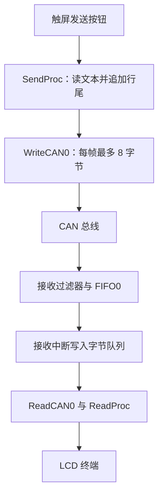

# 第十章 · GD32 CAN 总线与工程实战

## 一、总览：这个工程实现了什么

本章工程 **10.CAN** 是一个带触摸屏界面的经典 CAN 通信示例。Keil 工程目标为 **GD32F303ZE**。在界面输入发送 ID 和文本后，程序将文本拆成标准 CAN 数据帧，并附加回车与换行。接收端默认接收 **ID 为 `0x5A5` 的标准数据帧**，把各帧的载荷拼成文本后显示在 LCD 终端。

| 项目 | 当前工程配置 |
| --- | --- |
| CAN 外设 | CAN0，正常模式 `CAN_NORMAL_MODE` |
| MCU 侧引脚 | PA11 为 CAN0_RX，上拉输入；PA12 为 CAN0_TX，复用推挽输出 |
| 标称位速率 | 1 Mbit/s，宏 `CAN_BAUDRATE = 1000` |
| 发送帧 | 标准数据帧，发送 ID 由界面输入决定 |
| 接收过滤 | 过滤器 0，32 位掩码模式，匹配标准数据帧 `0x5A5` |
| 接收路径 | 硬件 FIFO0 → 接收中断 → 1024 字节软件环形队列 → LCD |
| 应用调度 | 主循环约每 40 ms 执行一次 `CANTopTask()`；触摸约每 20 ms 扫描一次 |
| 文本规则 | 发送端追加 `\r\n`，接收端遇到该序列显示一行，也会尝试显示超时的残留文本 |



图中的收发可以发生在两块板上，或由开发板和 USB-CAN 适配器配合完成。原工程在正常模式下运行，本机自收自发实验需要改用回环模式。

## 二、分解：协议、源码和动手实验

### 2.1 CAN 基础

**CAN（Controller Area Network，控制器局域网）** 是一种多节点共享的串行总线。各节点都能观察总线上的报文，并通过过滤器挑选自己关心的报文。ID 通常代表消息的含义和仲裁优先级；项目也可以在应用协议里约定用 ID 的部分位表示节点号或功能。

#### 物理层：控制器、收发器和终端电阻

MCU 内的 CAN 控制器负责组帧、仲裁、CRC、ACK 和验收过滤。外部 **CAN 收发器**负责在 MCU 的 TX/RX 逻辑信号与 CANH/CANL 差分信号之间转换。实物上先确认板载收发器与终端电阻的配置。若需要外接收发器，PA12 接收发器 TXD，PA11 接收发器 RXD，总线侧 CANH 对 CANH、CANL 对 CANL。非隔离台架按硬件设计共参考地。

高速 CAN 通常以双绞线作主干，支线尽量短，主干两端各有一个 120 Ω 终端电阻。全网断电、两个终端都接入时，在典型台架上量 CANH 与 CANL，读数约为 60 Ω。终端是否内置、收发器是否处于工作状态，需要根据板卡或适配器实物确认。

#### 数据链路层：一帧里有什么

| 字段或类型 | 含义 | 工程里的对应项 |
| --- | --- | --- |
| SOF / EOF | 标记帧开始和结束 | 由控制器生成与识别 |
| 仲裁与格式 | 标准 ID 为 11 位，范围 `0x000`–`0x7FF`；扩展 ID 为 29 位 | 本工程用 `tx_sfid` 与 `CAN_FF_STANDARD` |
| IDE / RTR | IDE 区分标准与扩展格式，RTR 区分数据帧与远程帧 | 本工程发送 `CAN_FT_DATA` |
| DLC 与数据段 | 经典 CAN 数据帧载荷为 0～8 字节，实验使用 DLC 0～8 | `tx_dlen`、`tx_data[]`、`rx_dlen`、`rx_data[]` |
| CRC / ACK | CRC 用于校验；ACK 表明至少一个可应答节点正确接收了该帧 | 控制器处理，应用可检查发送状态 |
| 特殊帧 | 远程帧请求对应 ID 的数据且没有载荷；错误帧和过载帧用于协议控制 | 当前文本演示处理标准数据帧 |

CAN FD 可携带最多 64 字节，并可使用更快的数据阶段位速率。本章工程使用经典 CAN，长文本由应用拆为多帧。

#### 仲裁、确认和错误状态

- **逐位仲裁。** 总线上显性位 0 覆盖隐性位 1。若两个标准数据帧同时起发，从 ID 的高位开始比较，先发出隐性位且读到显性位的节点退出本轮仲裁。例如 `0x100` 与 `0x5A5` 同时争用总线时，`0x100` 先发。输掉仲裁的节点等待下一次机会。
- **ACK 与验收过滤是两件事。** 正常工作的接收节点可以对正确收到的帧作 ACK，即便这帧未通过其本地应用验收过滤。因此，适配器发送 `0x5A4` 可以有 ACK，开发板仍然可以不显示。静默监听模式的适配器通常不会发 ACK。
- **错误处理。** 控制器监控位错误、填充错误、CRC 错误、格式错误和 ACK 错误。发送错误计数 TEC 与接收错误计数 REC 影响节点的 Error Active、Error Passive 状态；发送错误持续累积还可能使节点进入 Bus-off。工程启用了自动重传，但关闭了自动 Bus-off 恢复。
- **位填充。** 经典 CAN 在需要填充的区间内，连续五个同极性的位后插入一个反极性位，帮助维持同步。计算总线负载时，除载荷外还要考虑协议字段、位填充、帧间隔和可能的重传。

### 2.2 配置：位速率和过滤器怎么算

#### 从 APB1 算出 1 Mbit/s

`HW/RCU/RCU.c` 配置的系统时钟为 120 MHz，APB1 二分频得到 60 MHz。CAN0 位于 APB1。按工程正常时钟配置，`ConfigCAN0()` 使用同步段 1 TQ、BS1 = 5 TQ、BS2 = 4 TQ、SJW = 1 TQ。SJW 限制一次重同步时对位段的调整幅度。

```text
每位 TQ 数 = 1 + BS1 + BS2 = 1 + 5 + 4 = 10
位速率     = 60 MHz ÷ prescaler ÷ 10
采样点     = (1 + BS1) ÷ 10 = 60%
```

| `CAN_BAUDRATE`（kbit/s） | `prescaler` | 单个位时间 |
| ---: | ---: | ---: |
| 1000 | 6 | 1 µs |
| 500 | 12 | 2 µs |
| 250 | 24 | 4 µs |
| 125 | 48 | 8 µs |
| 100 | 60 | 10 µs |
| 50 | 120 | 20 µs |
| 20 | 300 | 50 µs |

库函数 `can_init()` 会把 `prescaler - 1` 写入寄存器字段。若将 `CAN_BAUDRATE` 改为 500，适配器也应切到 500 kbit/s。LCD 上的速率字样由 `InitCANTop()` 单独写死，做变速实验时可同步改成对应值；`1MBps` 建议显示为 `1 Mbit/s`。移植到其他 MCU 或更改时钟树时，应使用新的 CAN 外设时钟重新计算位时序。60% 是这组参数算出的采样点，跨设备调试还需要考虑传播延时和对端的位时序。

#### 从标准 ID 算出过滤器值

源码将 11 位标准 ID 放在过滤字的 `[31:21]` 位，并分别写入高、低 16 位。对于本例，IDE 和 RTR 都为 0。

```text
匹配值 = 0x5A5 << 21 = 0xB4A00000
高 16 位 = 0xB4A0，低 16 位 = 0x0000
掩码 = 0xFFFFFFFF
验收条件：(报文标识字段 & 掩码) == (匹配值 & 掩码)
```

掩码的一位为 1，表示该位必须匹配。全掩码同时约束 ID、IDE、RTR，因此同 ID 的远程帧，以及高位相同的扩展帧，也会被挡在 FIFO0 之外。若做一个接收 `0x5A0`–`0x5AF` 标准数据帧的实验，可将匹配值设为 `0x5A0 << 21`，掩码设为 `(0x7F0u << 21) | (1u << 2) | (1u << 1)`，并分别填入两个 16 位字段。其中低四位标准 ID 任意，IDE 与 RTR 仍必须为 0。多个 ID 共用当前字节队列时，应用无法知道每段载荷的来源，实验中可用调试器查看 `rx_sfid`。

### 2.3 源码导读与重要函数

相对路径以工程目录 `10.CAN/` 为基准。建议按表中顺序打开文件。

| 文件 | 阅读重点 |
| --- | --- |
| [App/Main/Main.c](App/Main/Main.c) | `main()`、硬件与应用初始化、周期调度 |
| [HW/RCU/RCU.c](HW/RCU/RCU.c) | `ConfigRCU()` 如何设置 APB1 |
| [HW/CAN/CAN.c](HW/CAN/CAN.c) / [CAN.h](HW/CAN/CAN.h) | CAN0 参数、过滤器、收发接口和中断 |
| [FW/Source/gd32f30x_can.c](FW/Source/gd32f30x_can.c) / [gd32f30x_can.h](FW/Include/gd32f30x_can.h) | 固件库如何操作发送邮箱、接收 FIFO 和状态寄存器 |
| [HW/UART0/Queue.c](HW/UART0/Queue.c) | CAN 复用的字节环形队列，观察 `front`、`rear`、`elemNum` |
| [App/CANTop/CANTop.c](App/CANTop/CANTop.c) | GUI 回调、文本拆分、行结束处理 |
| [App/EmbGUI/App/GUITop.c](App/EmbGUI/App/GUITop.c) / [GUILineEdit.c](App/EmbGUI/Module/GUILineEdit.c) | 发送按钮入口、十六进制 ID 的解析、终端显示 |

#### 初始化

| 函数 | 调用与作用 |
| --- | --- |
| `main()` | 执行 `InitHardware()`，其中 `InitRCU()` 比 `InitCAN()` 早；随后执行 `InitSoftware()` 初始化界面和回调 |
| `InitCAN()` | 初始化 1024 字节接收队列，再调用 `ConfigCAN0()`，使接收中断启用前已有缓冲区 |
| `ConfigCAN0()` | 开启 CAN0、GPIOA 和复用时钟，配置 PA11/PA12，初始化参数，复位外设，设置位时序与过滤器，最后使能 FIFO0 非空事件及对应 NVIC IRQ |
| `can_struct_para_init()` / `can_init()` | 前者设置结构体默认值，后者配置控制器并返回 `SUCCESS` 或 `ERROR`。现有调用点未使用返回值 |
| `can_filter_init()` | 将掩码与匹配字写入指定过滤器，选择 FIFO0，最后启用过滤器 |
| `InitCANTop()` | 配置 GUI 标签，将 `SendProc` 注册为发送回调，再调用 `InitGUI()`；GUI 标签本身只负责显示 |

FIFO0 中断应以源码实际调用为准，入口是 **`USBD_LP_CAN0_RX0_IRQHandler`**，对应 `USBD_LP_CAN0_RX0_IRQn`，使能项为 `CAN_INT_RFNE0`。

#### 发送

1. `GUITask()` 读取发送框里的 ID 和文本，调用 `sendCallBack(id, data)`。输入示例用 **`5A5`**。解析器逐字符按十六进制累加，遇到非十六进制字符即停止。填 `0x5A5` 时会在 `x` 处停下，解析值会变成 0。
2. `SendProc()` 数出字符串长度，调用 `WriteCAN0()` 发送正文，然后分别再调用一次发送 `0x0D` 和 `0x0A`。字符串结尾的 NUL 不发送。
3. `WriteCAN0(id, buf, len)` 填好标准帧 ID、类型和格式，把载荷按每帧最多 8 字节复制到发送结构体。每提交一片之前，原代码会等到三个邮箱**全部**不处于 `CAN_TRANSMIT_PENDING`，属于阻塞式等待。
4. `can_message_transmit(CAN0, &msg)` 找一个空闲邮箱，写入报文并发出发送请求。返回邮箱号或 `CAN_NOMAILBOX`。获得邮箱号表示请求已提交。需要确认总线发送结果时，用 `can_transmit_states(CAN0, mailbox)` 查询对应邮箱的 `PENDING`、`OK` 或 `FAILED`。原来的 `WriteCAN0()` 未传回这些状态，也没有在最后一帧提交后等待该帧完成。

#### 接收

1. 硬件过滤命中后将报文放进 FIFO0，并触发中断。`USBD_LP_CAN0_RX0_IRQHandler()` 每次处理一帧，调用 `can_message_receive(CAN0, CAN_FIFO0, &msg)`。
2. `can_message_receive()` 读取 ID、帧格式、帧类型、DLC、载荷等字段，并在库函数内部释放这条 FIFO 条目。随后中断把标准帧的载荷字节交给 `EnQueue()`。软件队列保存的是载荷字节流，读取方无从获取原始 ID、DLC 和帧边界。
3. `ReadCAN0(buf, len)` 最多取 `len` 个字节，返回实际读取数。无数据返回 0。工程里的 `ReadProc()` 每次取 1 字节。
4. `CANTopTask()` 在主循环约每 40 ms 调用，先执行 `ReadProc()`，再执行 `GUITask()`。`ReadProc()` 用 48 字节缓冲区拼行，检测到 `\r\n` 后加 NUL 并通过 `showLine()` 显示。如果未凑成一行，从应用开始收集这段残留数据起超过 250 ms，也会尝试显示。超时在任务运行时检查，因此显示时刻还受任务周期影响。

### 2.4 函数应用与抓包实验

以下实验可用一块开发板和一个支持经典 CAN 的 USB-CAN 适配器。实验值由源码推导，可按表逐项在台架核对。

#### 应用 A：发送一帧，不经过 GUI

在初始化完成后的单次测试入口调用。为正常模式准备可应答的对端。

```c
#include "CAN.h"

void SendHelloOnce(void)
{
    u8 data[] = {'H', 'E', 'L', 'L', 'O'};
    WriteCAN0(0x5A5, data, sizeof(data));
}
```

期望抓到标准数据帧 `ID=0x5A5`、`DLC=5`、`48 45 4C 4C 4F`。该调用只发送这五个字节。若由运行本工程的另一块板接收，`ReadProc()` 的残留文本超时逻辑会在后续调度时显示它。要让对端检测到立即成行的条件，可再发送含 `0D 0A` 的匹配数据。

#### 应用 B：用 GUI 发送长于 8 字节的文本

输入发送 ID `5A5`、正文 `CAN-DEMO-01`，按发送按钮。适配器在 1 Mbit/s 下应看到以下四帧。

| 帧次序 | DLC | 载荷（十六进制） | 含义 |
| ---: | ---: | --- | --- |
| 1 | 8 | `43 41 4E 2D 44 45 4D 4F` | `CAN-DEMO` |
| 2 | 3 | `2D 30 31` | `-01` |
| 3 | 1 | `0D` | 回车 |
| 4 | 1 | `0A` | 换行 |

四帧的标准 ID 均为 `0x5A5`。反向验证时，适配器可用一帧发送标准 ID `0x5A5`、数据 `48 49 0D 0A`，开发板应在接收任务执行后显示 `HI`。现有逻辑允许回车、换行在同一帧或分属两帧。

#### 应用 C：对照验证验收过滤

用适配器每次单独发送一条，观察 LCD 或 FIFO0 中断计数。

| 帧格式 | 帧类型 | ID | 内容 | 板端预期 |
| --- | --- | --- | --- | --- |
| 标准 | 数据 | `0x5A5` | `4F 4B 0D 0A` | 显示 `OK` |
| 标准 | 数据 | `0x5A4` | 同上 | 不进入 FIFO0 |
| 扩展 | 数据 | `0x16940000`（高 11 位等于 `0x5A5`） | 同上 | IDE 不匹配，不进入 FIFO0 |
| 标准 | 远程 | `0x5A5` | 无数据载荷 | RTR 不匹配，不进入 FIFO0 |

#### 应用 D：排查“有波形却收不到”或“点击后界面卡住”

| 现象 | 先验证 | 对应位置 |
| --- | --- | --- |
| 适配器无帧或持续报 ACK 错误 | 对端处于正常模式、位速率一致、收发器已使能、H/L 与终端配置正确 | `ConfigCAN0()`、`can_error_get()`、`can_transmit_error_number_get()` |
| 适配器看到有效帧，板端没有接收 | ID、IDE、RTR、过滤器分配的 FIFO、NVIC 是否匹配 | `can_filter_init()`、`USBD_LP_CAN0_RX0_IRQHandler()` |
| 中断收到帧，屏幕无完整行 | 帧里是否带真实字节 `0D 0A`、队列是否拥堵、任务是否继续运行 | `EnQueue()`、`ReadCAN0()`、`ReadProc()` |
| 发送长文本时界面停住 | 查看邮箱是否持续 `PENDING`。缺 ACK 且自动重传时，下一段发送可能一直等邮箱 | `WriteCAN0()`、`can_transmit_states()` |

调试正常总线时，可在中断中仅打计数或采集少量状态，在主循环输出诊断结果。长时间停在接收中断断点可能改变总线实时表现。

### 2.5 学习路径

| 阶段 | 动手任务 | 过关标准 |
| --- | --- | --- |
| 1. 看懂一帧 | 对照 `CAN.c` 写出 `0x5A5` 标准数据帧的 ID、格式、DLC 和载荷，算出 1 Mbit/s 和 60% 采样点 | 能从源码解释位速率、采样点与 SJW |
| 2. 跑通单板回环 | 临时把 `working_mode` 切成 `CAN_SILENT_LOOPBACK_MODE`，用 `0x5A5` 发一帧，观察 FIFO0 中断与 `rx_data` | 不依靠外部对端，也能验证 MCU 的发送、过滤和接收链；做双节点实验前切回正常模式 |
| 3. 跑通双节点 | 按应用 B 抓四帧，再用适配器反向发送 `48 49 0D 0A` | 抓包与屏幕显示都符合预期 |
| 4. 修改参数做对照 | 切换到 500 kbit/s，再把验收条件从单个 ID 改为一组 ID | 能预测每种设置下的抓包结果和中断次数 |
| 5. 用 CAN 传二进制量 | 约定单帧 ID 和数据布局，抓包验证编码；接收端保留整帧并按 ID/DLC 解析 | 能区分总线帧边界、字节顺序和工程的文本换行协议 |
| 6. 处理异常 | 给发送等待设超时，并记录初始化失败、邮箱提交结果、发送状态及接收丢包计数 | 断开对端后应用仍可继续调度，并能报告所处状态 |

阶段 5 可用低频模拟电机状态作为练习。例如约定 `0x301` 的数据由两字节无符号转速（小端、单位 rpm）和一字节状态组成。600 rpm、状态 1 编码为 `58 02 01`。接收端需允许 `0x301`，检查标准数据帧且 DLC 等于 3，再用 `data[0] | ((uint16_t)data[1] << 8)` 还原转速。现有 `ReadCAN0()` 只提供字节流，整帧解析需要在取 FIFO 时保留格式、ID、DLC 和数据，并交给按帧保存的接收队列。

#### 从教学示例迁移时要读懂的边界

- `WriteCAN0()` 在进入分片循环前先读 `buf[0]`。调用原函数时传有效缓冲区和非零长度；要支持零载荷数据帧，可直接通过固件库构造 `tx_dlen = 0` 的帧，并检查邮箱结果。
- 接收中断将 `rx_dlen` 原样交给 `EnQueue()`，而库从四位 DLC 字段取值、数据数组只有 8 字节。若扩展通用接收接口，按协议与硬件行为处理 DLC，并将数据访问约束在数组范围内。
- `EnQueue()` 可能只写入部分字节，现有中断忽略其返回长度。`EnQueue()` 与 `DeQueue()` 分别在中断、主循环更新同一个 `elemNum`，读改写存在竞争。连续或高频接收时，需保证队列并发一致性，并统计硬件 FIFO 与软件队列的溢出。
- `ReadProc()` 的 48 字节缓冲区使用取模回绕。若依赖完整的 `\r\n` 成行，正文控制在 **45 字节**以内，另外为 CR、LF 和 NUL 各留 1 字节。任意长度的二进制数据可以包含 `0D 0A` 或 NUL，适合用明确的长度和帧结构解析。
- 长文本拆片无序号、总长度和消息来源字段。若多个发送节点共用同一 ID，片段可能混在一起。多帧应用可约定消息来源、序号、长度和重组超时，或者使用双方都支持的现成传输协议。

### 2.6 参考资料

- [GigaDevice《GD32F30x User Manual》Rev. 3.4](https://www.gd32mcu.com/data/documents/userManual/GD32F30x_User_Manual_Rev3.4.pdf)，查第 8 章的引脚映射和第 22 章的 CAN 邮箱、过滤器、位时序及寄存器。
- [Kvaser CAN Protocol Tutorial](https://kvaser.com/can-protocol-tutorial/)，查帧格式、仲裁、ACK 与错误处理。
- [TI《Controller Area Network Physical Layer Requirements》](https://www.ti.com/lit/an/slla270/slla270.pdf)，查高速 CAN 布线、收发器与终端电阻。

## 三、总结：把发送和接收各走一遍

复盘发送时，从 `SendProc()` 出发，用一行 `CAN-DEMO-01` 数清楚四个帧，区分邮箱提交、发送状态和应用层显示。复盘接收时，从 `0x5A5 << 21` 出发，跟着报文走过过滤器、FIFO0、中断和字节队列，直到 `ReadProc()` 因 `0D 0A` 显示整行。

学完本章，用三项实验验收：**单板回环能收、双节点能抓到四帧、错误的 ID 或帧格式不会进入 FIFO0。** 接下来为一个 3 字节电机状态报文定义 ID、字节序、单位和 DLC，再从抓包结果反推转速与状态。
